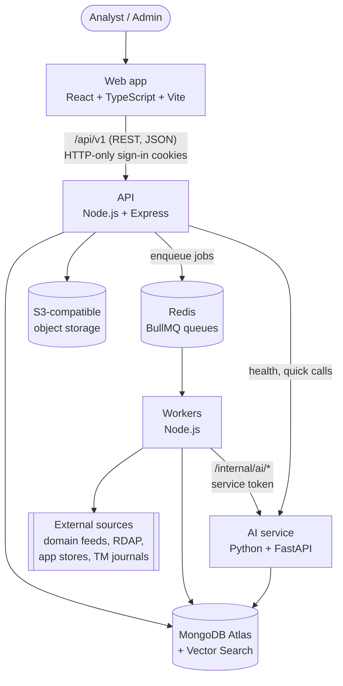

# Similo — Architecture

This document explains how the system is put together and why. Read it before changing the structure.

## 1. System overview



**Built in Phase 1:** the web app, the API, the AI service, the health checks between them, and the MongoDB connection code.
**Phase 5:** Redis/BullMQ queueing, a separate monitoring worker, Certificate Transparency discovery, RDAP enrichment and tenant-scoped findings. Object storage and other source adapters remain planned (see the [roadmap](#roadmap)).

### Who is responsible for what

| Component                  | Responsible for                                                         | Never does                                                              |
| -------------------------- | ----------------------------------------------------------------------- | ----------------------------------------------------------------------- |
| **Frontend** (`frontend/`) | UI, routing, forms, calling the API                                     | Hold secrets, enforce security (UI only hides things; the API enforces) |
| **Backend** (`backend/`)   | Auth, organisations, RBAC, CRUD, validation, audit logs, enqueuing jobs | Long-running monitoring or AI work inside a request                     |
| **Workers** (Phase 5)      | Scheduled monitoring, source enrichment and finding creation            | Serve browser traffic                                                   |
| **AI service** (`ai/`)     | Similarity, OCR, embeddings, risk scoring, RAG                          | Talk to browsers, decide tenant access on its own                       |

## 2. Why this shape

- **Two backends (Node + Python).** Node/Express is a good fit for the request/response
  work: auth, CRUD and validation. Python has the ML ecosystem (sentence-transformers,
  OpenCV, OCR). Splitting them lets each use its best tools, and lets the AI service scale
  separately (it is CPU/GPU-heavy, the API is I/O-heavy).
- **Queues between the API and AI work.** Monitoring a brand or OCR-ing a 200-page journal can
  take minutes. Doing that inside an HTTP request would time out and block other users.
  The API puts a job on a queue and returns immediately, a worker does the work, and the
  UI shows progress.
- **One database (MongoDB Atlas) for documents and vectors.** Atlas Vector Search keeps RAG
  embeddings next to the data they describe, so there is no second database to run.
  The organisation filter is applied to every vector query, just like a normal query.

## 3. Request flow (Phase 1)

```
Browser ─GET /api/v1/health/dependencies─▶ Vite dev server (5173)
        ─proxy─▶ Express (4000)
           request-logger → helmet → cors → json parser → router → controller → service
                                                                    ├─ ping MongoDB (timeout 3s)
                                                                    └─ GET http://localhost:8000/health (timeout 3s)
        ◀─ { success: true, data: { status: "degraded", dependencies: [...] } }
```

**The dev proxy.** In development the browser only talks to `localhost:5173`, and Vite
forwards `/api` to Express. Because the browser sees a single origin, CORS is not needed,
and HTTP-only cookies (Phase 2) work exactly as they will in production behind one domain.

## 4. API conventions

- **Versioning:** every route lives under `/api/v1`.
- **Response envelope:** every response has one of two shapes:
  - Success: `{ "success": true, "data": … }`
  - Failure: `{ "success": false, "error": { "code", "message", "requestId", "details?" } }`
  - `code` is stable and machine-readable (`NOT_FOUND`, `VALIDATION_ERROR`, …).
  - `message` is safe to show to users.
  - Unexpected errors become a generic `INTERNAL_ERROR`. Stack traces and internal messages are never sent to clients.
- **Request IDs:** every response carries `X-Request-Id`, which also appears on every log line
  for that request. Error responses repeat it as `error.requestId`.
- **Validation:** request bodies, params and queries are validated with Zod. A `ZodError` becomes `400 VALIDATION_ERROR` with per-field details.
- **Layers:** `routes → controller (thin, HTTP only) → service (business logic) → model/client`.
  Services never touch `req`/`res`, so they can be tested without HTTP.
- **Health endpoints:**
  - `GET /api/v1/health` is liveness and always returns 200 while the process runs.
  - `GET /api/v1/health/dependencies` is the dependency report:
    - `ok`: everything is up.
    - `degraded`: an optional dependency is down or not configured.
    - `down`: a critical dependency (the database) is down.
  - The dependency report will be restricted to admins in Phase 2.
- **AI service responses** are plain FastAPI JSON. The envelope is only used by the public API, and the Node client validates every AI response with Zod.

## 5. Security baseline

| Concern               | Phase 1                                                                                                                                                                                                                                                                                                                                                                                                                                                                                | Planned                                                                      |
| --------------------- | -------------------------------------------------------------------------------------------------------------------------------------------------------------------------------------------------------------------------------------------------------------------------------------------------------------------------------------------------------------------------------------------------------------------------------------------------------------------------------------- | ---------------------------------------------------------------------------- |
| Secrets               | Read from environment variables and validated at startup; `.env` is git-ignored; error messages name the variable but never show its value                                                                                                                                                                                                                                                                                                                                             | Secret manager in production                                                 |
| HTTP headers          | `helmet` (CSP, HSTS, nosniff, frame options); `X-Powered-By` removed                                                                                                                                                                                                                                                                                                                                                                                                                   | —                                                                            |
| CORS                  | Allow-list only (`CORS_ORIGINS`), credentials enabled                                                                                                                                                                                                                                                                                                                                                                                                                                  | —                                                                            |
| Body limits           | JSON bodies limited to 1 MB                                                                                                                                                                                                                                                                                                                                                                                                                                                            | —                                                                            |
| Log hygiene           | `authorization`, `cookie` and `set-cookie` headers redacted; request logs keep only method, URL and status                                                                                                                                                                                                                                                                                                                                                                             | —                                                                            |
| AI service            | Not exposed to browsers; `/docs` disabled in production                                                                                                                                                                                                                                                                                                                                                                                                                                | Shared service token for worker calls (planned)                              |
| Auth / RBAC / tenancy | Phase 2: Argon2id passwords (at least 10 characters); a 15-minute HS256 JWT access token plus a random refresh token, both in HTTP-only, SameSite=Lax cookies (`__Host-` + Secure in production); only the refresh token's SHA-256 hash is stored (idle 7 d, absolute 30 d); five roles checked per route with `requirePermission`; role and membership read on every request. Trade-off: a copied access token keeps working for up to 15 minutes after sign-out or a password change | MFA and SSO (Phase 10)                                                       |
| Rate limiting         | Demo requests 5/15 min; sign-in 10/15 min; sign-up 5/h; invitation links 30/15 min (per client, `express-rate-limit`); account pause for 15 min after 5 wrong passwords                                                                                                                                                                                                                                                                                                                | Shared Redis store when the API runs on several instances                    |
| CSRF                  | Phase 2: SameSite=Lax cookies plus an `Origin` allow-list check on every POST/PATCH/DELETE (`verifyOrigin`)                                                                                                                                                                                                                                                                                                                                                                            | —                                                                            |
| Audit                 | Phase 2: append-only audit log (sign-ins, failures, lockouts, invitations, role changes, removals) with actor, target, IP; Phase 4: every brand change                                                                                                                                                                                                                                                                                                                                 | Export and retention settings                                                |
| File uploads          | Phase 4: brand logos only; `multer` in memory, 1 file of at most 1 MB, refused while it streams in; type decided by magic bytes (PNG, JPEG, WebP), never by the name or the browser's type; SVG and GIF refused; file name cleaned for display; served by a signed-in route with the sniffed `Content-Type`, `nosniff`, `Content-Security-Policy: default-src 'none'`, `Content-Disposition: inline`, `Cache-Control: private`                                                         | Malware scanning and object storage before any other file types are accepted |
| Candidate fetching    | Phase 5 does not fetch candidate websites; CT and RDAP requests use fixed or IANA-listed hosts, HTTPS, redirects disabled and timeouts                                                                                                                                                                                                                                                                                                                                                 | Private-address checks for any future URL-fetching adapters                  |

## 6. Multi-tenancy and authorisation (built in Phase 2)

- Every tenant-owned document has an `organizationId`, and every collection has compound indexes that start with `organizationId`.
- The organisation comes from the **authenticated session**, never from the request body or URL.
- The repositories/services that serve requests take `organizationId` as a required argument,
  so it is impossible to write an unscoped query by accident. Tests check that organisation A
  cannot read organisation B's data.
- Roles: Owner, Admin, Investigation Analyst, Legal Reviewer, Viewer. The API checks them per
  action (`requirePermission('findings:update')`). The UI only hides buttons.
- **Sign-in tokens (JWT since commit `ac7f510`):** two HTTP-only, `SameSite=Lax` cookies
  (`__Host-` prefix and `Secure` in production), so page scripts can never read them.
  - **Access token:** a JWT signed with HS256 (`jose`, secret `JWT_SECRET`), valid for 15
    minutes. It holds only ids (user, organisation, session), never the role, so checking it
    needs no database lookup (`backend/src/modules/auth/access-token.ts`).
  - **Refresh token:** a random value; MongoDB stores only its SHA-256 hash in `sessions`
    (signed out after 7 days idle or 30 days at most; TTL index). When the access token is
    missing or expired, `requireAuth` uses it to issue a new access token silently.
  - **Role and membership are read on every request**, so a role change, or removal from the
    organisation, applies to the very next request.
  - **Trade-off, stated honestly:** signing out deletes that session's refresh token, and
    changing the password deletes every other session's, at once. But an access token copied
    before that keeps working until it expires, at most 15 minutes later. Removal from the organisation still applies immediately, because the
    membership check on every request fails. Short-lived access tokens are the usual way to
    limit this risk without a database lookup for the session on every request.
- Proven by `backend/test/tenant-isolation.test.ts`: with the other organisation's real IDs,
  members, invitations, audit entries, and (Phase 4) brands with their domains, trademarks and
  logos are invisible and unchangeable on every route (404), and an `organizationId` sent in a
  request body is ignored.

## 7. Data sources and their limits

The platform must not claim coverage it doesn't have. Each source is an adapter behind an interface, so a source that is not yet approved can be swapped for clearly labelled test fixtures.

| Module            | Candidate sources                                                                                                               | Constraint                                                                                                                                              |
| ----------------- | ------------------------------------------------------------------------------------------------------------------------------- | ------------------------------------------------------------------------------------------------------------------------------------------------------- |
| Domain discovery  | Phase 5: crt.sh Certificate Transparency search; reserved `.example` fixtures for development; future ICANN CZDS/licensed feeds | CT results are incomplete and delayed, and only cover names with certificates. CZDS needs approval per TLD. RDAP is **only enrichment**, not discovery. |
| Domain enrichment | Phase 5: RDAP via the official IANA DNS bootstrap                                                                               | Registry rate limits apply; contact data is often redacted. Only registration date, registrar name and nameservers are stored.                          |
| Apps              | Apple iTunes Search API (public, documented); licensed data providers                                                           | There is no official public Google Play search API. The Play Developer API only covers your own apps.                                                   |
| Trademarks        | IP India trademark journals (PDF); WIPO Global Brand Database where its terms permit                                            | No comprehensive global coverage; the OCR quality of journal PDFs varies                                                                                |

## 8. Key decisions

| #   | Decision                                                                                                                                                     | Why                                                                                                                                                                                                        |
| --- | ------------------------------------------------------------------------------------------------------------------------------------------------------------ | ---------------------------------------------------------------------------------------------------------------------------------------------------------------------------------------------------------- |
| D1  | npm workspaces monorepo (no pnpm/Turborepo)                                                                                                                  | Built into npm, nothing extra to install; can be upgraded later                                                                                                                                            |
| D2  | TypeScript pinned to 6.0.x                                                                                                                                   | TypeScript 7 (the native Go compiler) is out, but `typescript-eslint` supports only up to 6.0. Revisit when it supports 7.                                                                                 |
| D3  | Express 5                                                                                                                                                    | Async errors reach the error handler automatically (no try/catch in every route)                                                                                                                           |
| D4  | ESM + `NodeNext` in the API                                                                                                                                  | Matches Node's native module system. Relative imports end in `.js` even in `.ts` files, because that is the file Node runs after compiling.                                                                |
| D5  | Zod for API env/request validation                                                                                                                           | One schema gives both runtime validation and TypeScript types                                                                                                                                              |
| D6  | pino logging                                                                                                                                                 | Fast, structured JSON logs; readable output in development                                                                                                                                                 |
| D7  | Vite dev proxy for `/api`                                                                                                                                    | Same-origin in development, so no CORS and cookies just work                                                                                                                                               |
| D8  | Tailwind v4 `@theme` tokens; purple/violet palettes removed                                                                                                  | Brand colours are defined once; the "no purple" rule is enforced by the build                                                                                                                              |
| D9  | uv for Python, Python 3.12                                                                                                                                   | Fast, reproducible installs (`uv.lock`); 3.12 has the best ML/OCR wheel support                                                                                                                            |
| D10 | ML libraries added in Phase 6, not now                                                                                                                       | Keeps the foundation install small; nothing unused is installed                                                                                                                                            |
| D11 | `createApp(deps)` separate from `server.ts`                                                                                                                  | Tests build the app with fake dependencies, without a network port or database                                                                                                                             |
| D12 | `motion` library for UI animation; `MotionConfig reducedMotion="user"` plus explicit gating of looping animations                                            | Declarative scroll/entrance/parallax animation; visitors who ask for reduced motion get a still page (verified in a browser test)                                                                          |
| D13 | Hero globe and waves drawn on `<canvas>`, shield as SVG — no WebGL/three.js                                                                                  | Far smaller bundle; canvases pause off-screen and in hidden tabs; sharp at any size                                                                                                                        |
| D14 | Route-level code splitting (React Router `lazy`)                                                                                                             | Home loads instantly; other pages (2–7 kB each) download on first visit; form libraries only load on `/contact`                                                                                            |
| D15 | Resource articles as typed data in `src/content/`, not a CMS yet                                                                                             | Real content without new infrastructure; swapping to a CMS later changes one module                                                                                                                        |
| D16 | Demo requests: Zod validation, honeypot, 5 per 15 min rate limit, `503` when the DB is down                                                                  | A public form must resist spam and must never claim a request was saved when it was not                                                                                                                    |
| D17 | Design system v2 "Clarity" (`docs/DESIGN-SYSTEM.md`): light canvas, dark product stages, Geist + Instrument Serif                                            | v1 followed the common brand-protection template; v2 is distinct, calmer, and written in plain words for non-experts                                                                                       |
| D18 | Home-page brand checker runs entirely in the browser (`src/lib/lookalikes.ts`, unit-tested)                                                                  | A real, instant demo with no backend, no data collection and no fake results — it says it shows _possible_ imitations                                                                                      |
| D19 | Site-wide ⌘K / Ctrl K command menu built from `navigation.ts` and the resource content                                                                       | Fast keyboard navigation; one source of truth, so new pages and guides appear automatically                                                                                                                |
| D20 | Product renamed BrandShield → Similo; identifiers use `similo` (packages, services, default DB)                                                              | "BrandShield" is already the name of an existing brand-protection company; "Similo" comes from "similar"                                                                                                   |
| D21 | Sign-in: 15-minute HS256 JWT access token + random refresh token stored hashed in MongoDB, both in HTTP-only cookies (replaced opaque sessions in `ac7f510`) | No session lookup per request; refresh tokens are deleted instantly on sign-out; role and membership still checked on every request. Cost: a copied access token works for up to 15 minutes after sign-out |
| D22 | Argon2id via `@node-rs/argon2` (prebuilt, no compiler) with OWASP baseline settings                                                                          | Current OWASP recommendation; works on Windows without native build tools                                                                                                                                  |
| D23 | Invitations are one-time links shown once (hash stored), shared by the inviter; no email yet                                                                 | No email provider is configured; never pretend an email was sent                                                                                                                                           |
| D24 | Repositories take `organizationId` first; services get the organisation only from the session                                                                | An unscoped query can't be written by accident; request bodies can't choose a tenant                                                                                                                       |
| D25 | Auth tests on in-memory fakes with a controllable clock, plus an Atlas test in a throwaway database                                                          | Fast, deterministic tests of expiry and lockout; real proof of indexes and transactions                                                                                                                    |
| D26 | Brand logos stored in MongoDB (`brand_logos`, at most 1 MB each, 5 per brand), not object storage yet                                                        | No new infrastructure for a few small images; tenant-scoped like all data; deleted with their brand in one transaction. Revisit with S3-compatible storage when evidence files arrive (Phase 7)            |
| D27 | Logo type decided by magic bytes (PNG, JPEG, WebP); SVG refused                                                                                              | File names and browser types are chosen by the client; SVG can carry scripts, so serving it back is risky                                                                                                  |
| D28 | `multer` (memory storage) for multipart uploads                                                                                                              | The standard Express upload parser; enforces size and file-count limits while the upload streams in                                                                                                        |
| D29 | A brand's lists (keywords, domains, trademarks, logo details) embedded in one document with a `revision` number                                              | One read per brand page; the limits keep it small; an update only applies at the revision that was read, so two people saving at once can't undo each other or pass a limit                                |

## 9. Risks and open questions

| Risk / question                                                  | Impact                                                               | Proposed action                                                                                                                                               |
| ---------------------------------------------------------------- | -------------------------------------------------------------------- | ------------------------------------------------------------------------------------------------------------------------------------------------------------- |
| Project lives in OneDrive                                        | Slow installs, file-lock errors, GBs synced once ML libraries arrive | Move to a folder outside OneDrive                                                                                                                             |
| Node.js on the dev PC cannot resolve DNS SRV records             | `mongodb+srv://` strings fail with `querySrv ECONNREFUSED`           | Atlas M0 is connected with the standard (non-SRV) connection string; documented in README troubleshooting                                                     |
| No Redis or Docker on this machine                               | Blocks Phase 5 queues                                                | Choose one: Redis in WSL2, Memurai (Windows), or Redis Cloud free tier. Upstash is not ideal because BullMQ's frequent polling uses up its per-command quota. |
| CZDS approval lead time                                          | Real domain discovery delayed                                        | Apply now; develop against labelled fixtures and Certificate Transparency                                                                                     |
| Tesseract/PaddleOCR on Windows                                   | Native install friction                                              | Decide in Phase 6. Tesseract needs a system binary; PaddleOCR is pip-only but heavy.                                                                          |
| LLM provider and API key                                         | Needed for Phase 8                                                   | Provider abstraction; pick the provider at Phase 8                                                                                                            |
| Initial JS bundle is ~190 kB gzip (React, router, motion, query) | Slower first load on poor connections                                | Acceptable for now; revisit with vendor chunking and a Lighthouse audit in Phase 10                                                                           |
| npm 11 blocks esbuild's install script                           | None today (tsx and Vite work)                                       | Optional: `npm approve-scripts esbuild`                                                                                                                       |

## Roadmap

| Phase | Scope                                                                                      | Status                                   |
| ----- | ------------------------------------------------------------------------------------------ | ---------------------------------------- |
| 0     | Repository inspection, architecture                                                        | ✅ Done                                  |
| 1     | Foundation: monorepo, web, API, AI service, config, logging, errors, health checks         | ✅ Done (Atlas connected and verified)   |
| 2     | Authentication, organisations, roles, protected routes                                     | ✅ Done                                  |
| 3     | Public website: 11 pages, brand checker hero, resources, demo-request form + API endpoint  | ✅ Done (redesigned to v2 "Clarity")     |
| 4     | Brand management (brands, logos, domains, trademarks, monitoring config)                   | ✅ Done                                  |
| 5     | First end-to-end domain monitoring (discovery adapter, similarity, RDAP, BullMQ, findings) | Implemented; deployed worker still required to process scans |
| 6     | AI intelligence (text/image similarity, OCR, explainable risk scoring, evaluation set)     | Implemented in repository; hosted inference needs a model-capable AI instance |
| 7     | Investigations and evidence (provenance, SHA-256, timeline, reports)                       | —                                        |
| 8     | RAG assistant (ingestion, embeddings, vector search, cited answers, drafts)                | —                                        |
| 9     | App and trademark monitoring                                                               | —                                        |
| 10    | Production readiness (security audit, performance, deployment, backups)                    | —                                        |
| Later | MCP server (read-only tools, permission-checked)                                           | Extension point only                     |

### Phase 2 — accounts, organisations and roles

| Endpoint                                       | Who                        | Purpose                                       |
| ---------------------------------------------- | -------------------------- | --------------------------------------------- |
| `POST /auth/sign-up`, `POST /auth/sign-in`     | Anyone (rate-limited)      | Create an organisation + Owner; sign in       |
| `POST /auth/sign-out`, `GET /auth/me`          | Signed in                  | End this session; who am I, role, permissions |
| `POST /auth/change-password`                   | Signed in                  | Also signs out every other session            |
| `GET /auth/invites/:token`, `POST …/accept`    | Link holder (rate-limited) | Preview and accept an invitation              |
| `GET`/`PATCH /organization`                    | All / Owner, Admin         | Organisation summary; rename                  |
| `GET /organization/members`                    | All roles                  | Members with roles                            |
| `PATCH`/`DELETE /organization/members/:userId` | Owner, Admin (Owner rules) | Change role; remove (signs them out at once)  |
| `GET`/`POST`/`DELETE /organization/invites`    | Owner, Admin               | Pending invitations; create link; revoke      |
| `GET /audit-events`                            | Owner, Admin, Legal        | Audit log, newest first, cursor-paginated     |

Owner rules: only Owners can grant, change or remove the Owner role; nobody can change their own
role or remove themselves; an organisation always keeps at least one Owner.

Website: `/sign-in`, `/sign-up`, `/invite/:token` (focused layout) and the protected workspace
`/app` (Overview, Members, Audit log, Settings). `RequireAuth` only decides what to show; the API
enforces every rule.

### Phase 4 — brand management

Each organisation registers what it wants protected. All routes are under `/api/v1`, need
sign-in and the database, and look brands up only inside the caller's organisation (another
organisation's brand id answers 404, like an id that never existed).

| Endpoint                                                                       | Who          | Purpose                                                                                                      |
| ------------------------------------------------------------------------------ | ------------ | ------------------------------------------------------------------------------------------------------------ |
| `GET /brands`, `GET /brands/:brandId`                                          | All roles    | Brand list (newest first, with counts); one brand with all its details                                       |
| `POST /brands`, `PATCH`/`DELETE /brands/:brandId`                              | Owner, Admin | Create; change name, description, keywords, status; delete (its logos too)                                   |
| `POST /brands/:brandId/domains`, `DELETE …/domains/:domain`                    | Owner, Admin | Official domains, normalised (`https://www.Example.com/x` → `example.com`; `bücher.de` → `xn--bcher-kva.de`) |
| `POST /brands/:brandId/trademarks`, `PATCH`/`DELETE …/trademarks/:trademarkId` | Owner, Admin | Trademarks entered by hand: mark, office, number, Nice classes, status, date                                 |
| `PUT /brands/:brandId/monitoring`                                              | Owner, Admin | Monitoring settings used by Phase 5 domain scans; apps and trademarks are saved for later phases             |
| `POST /brands/:brandId/logos`, `DELETE …/logos/:logoId`                        | Owner, Admin | Upload (multipart field `logo`) or remove a logo                                                             |
| `GET /brands/:brandId/logos/:logoId`                                           | All roles    | The logo image, with the safe headers listed in §5                                                           |

Limits: 50 brands per organisation; per brand 50 keywords, 50 domains, 100 trademarks and 5 logos
of at most 1 MB. Brand names are unique per organisation, ignoring case (unique index on
`organizationId` + lower-cased name). Every change is written to the audit log
(`brand.created`, `brand.domain_added`, `brand.logo_uploaded`, …). Data lives in the `brands`
and `brand_logos` collections, and every document carries `organizationId`. `npm run seed:demo`
adds one sample brand, "Northwind Coffee (sample data)", on reserved `.example` domains.

### Phase 5 — first domain monitoring

The API queues work in BullMQ and a separate worker scans active brands whose domain monitoring
is enabled. A scheduled sweep runs every `DOMAIN_SCAN_INTERVAL_HOURS` (default 24); Owners,
Admins and Analysts can also queue an on-demand scan with `POST /api/v1/brands/:brandId/scan`
(limited to 10 requests per hour per client). The worker reads each tenant's brands by that
tenant's `organizationId` and carries both IDs in every scan job.

`DOMAIN_DISCOVERY_SOURCE=crtsh` searches recent crt.sh Certificate Transparency results for
brand names, keywords and official-domain labels. It uses a 90-day lookback and does not claim
complete registration coverage. `fixtures` (the development default) produces reserved
`.example` results, which are labelled as development fixtures in the UI; production refuses
fixture mode. The name-similarity score is a heuristic with a threshold set by the brand's
sensitivity. A qualifying CT candidate is enriched via the official IANA RDAP DNS bootstrap;
RDAP does not discover domains. Registry failures leave a finding without registration details
instead of discarding the CT candidate.

Findings are unique per organisation, brand and normalized domain. They retain first/last-seen
times, source references, match reasons and limited registration metadata, but no RDAP contact
records. `GET /api/v1/findings` is tenant-scoped and cursor-paginated; `PATCH /api/v1/findings/:id`
lets Owners, Admins and Analysts update review status. The dashboard lists and reviews findings
at `/app/findings`; status changes are written to the append-only audit log.

Set `REDIS_URL` and run `npm run dev` to start the worker with the API, or run
`npm run dev:worker` separately. Without Redis, the API remains available, the status page shows
the monitoring queue as not configured, and scan requests return 503. Phase 5 does not fetch
candidate websites; network requests go only to the fixed crt.sh and IANA bootstrap endpoints or
RDAP servers named by IANA, with redirects disabled and timeouts applied.

### Phase 3 — public website

| Route                                                              | Page                                                                                                                                                                                         |
| ------------------------------------------------------------------ | -------------------------------------------------------------------------------------------------------------------------------------------------------------------------------------------- |
| `/`                                                                | Home: plain-words hero + interactive brand checker (orbiting shield visual), 01 problem stories with alert cards, 02 auto-advancing "how it works", 03 bento of six checks, 04 teams, 05 FAQ |
| `/platform`, `/technology`                                         | "How it works" menu: the platform in plain words; "The AI, explained" — the one page with full technical depth                                                                               |
| `/solutions/domain-intelligence`                                   | Lookalike card, attack vectors, visual diff, RDAP telemetry, lifecycle, FAQ                                                                                                                  |
| `/solutions/trademark-intelligence`                                | Watch card, interactive matching pillars, scroll-linked workflow, case view, FAQ                                                                                                             |
| `/solutions/app-intelligence`, `/solutions/investigation-evidence` | App impersonation; cases, evidence vault, grounded assistant, drafting flow                                                                                                                  |
| `/resources`, `/resources/:slug`                                   | Searchable, filterable library of six real guides (`src/content/resources.ts`)                                                                                                               |
| `/about`, `/contact`                                               | Company principles; demo-request form → `POST /api/v1/demo-requests`                                                                                                                         |
| `/status`                                                          | Live system status (also shown in the footer)                                                                                                                                                |

**Content honesty.** The Stitch designs contained invented claims (Fortune 500 customers,
SOC 2 / ISO 27001 certifications, accuracy and latency figures, testimonials, logos of
trademark offices). These were replaced with accurate copy. Product visuals use sample data
and carry an "Illustrative example" tag; the footer says so too.

**Design system v2.** The first version looked too close to the usual brand-protection
template, so the site was rebuilt on a new design system (`docs/DESIGN-SYSTEM.md`): floating
island header with a ⌘K search, light canvas with framed dark product stages, plain-language
copy with technical names on a secondary "Under the hood" line, numbered chapters, and a
closing contained call-to-action panel. The brand palette from the product brief is unchanged.
